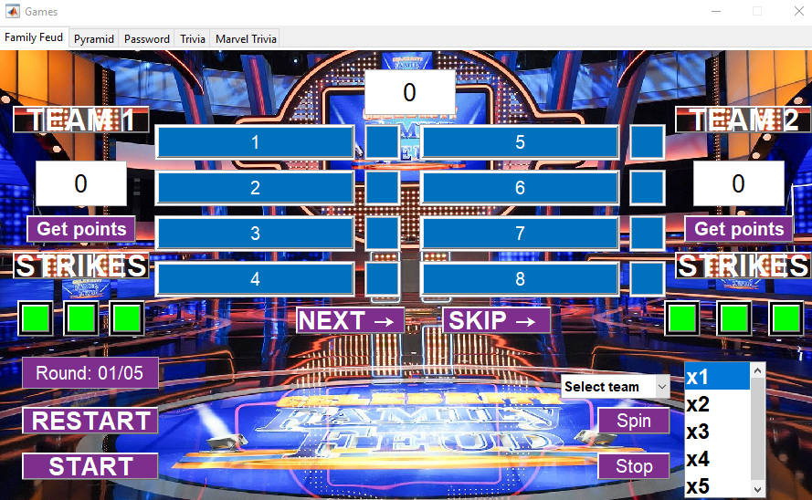
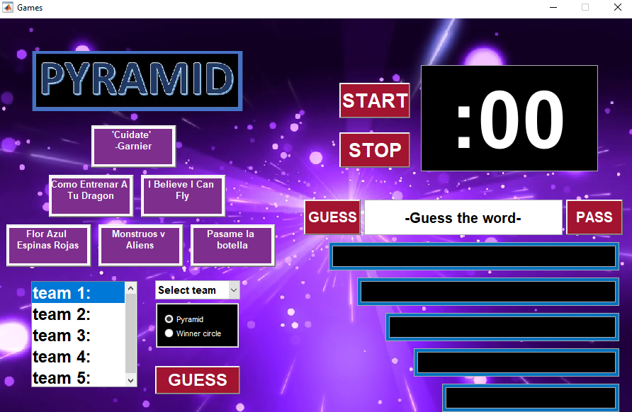
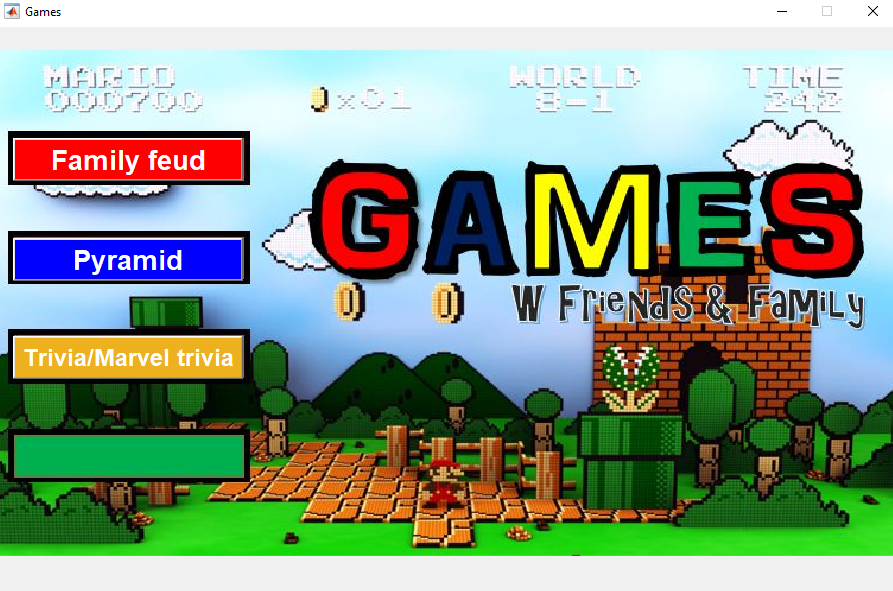
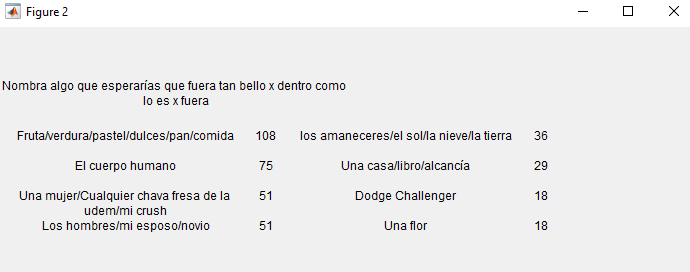
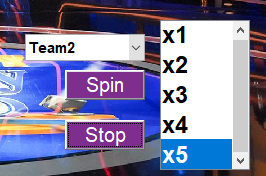
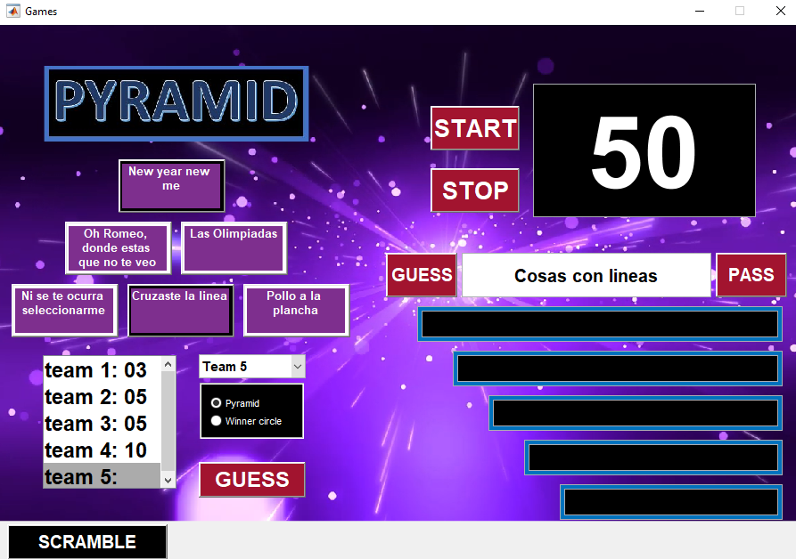
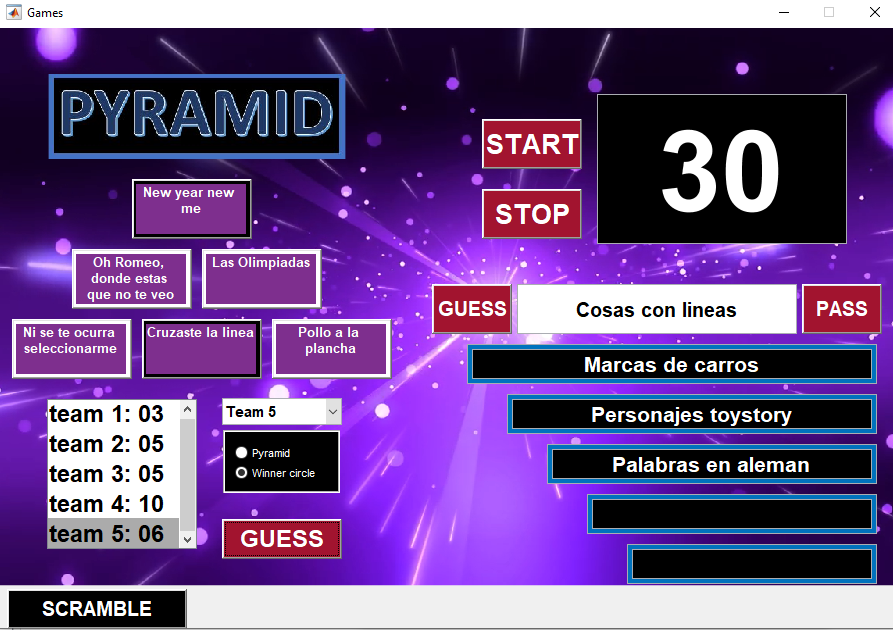

# Family Feud & Pyramid — Interactive MATLAB Games





**Two interactive, team-based games developed in MATLAB, featuring custom graphical user interfaces, randomized questions and categories, dual-screen presentation, timers, score management, multimedia backgrounds, sound effects, and multiple gameplay modes.**

## Overview

This project contains two interactive games developed using **MATLAB**, designed for group entertainment, friendly competitions, and team-based activities.

Both games feature graphical user interfaces (GUIs) that allow a moderator to coordinate gameplay, control the presentation of questions and answers, manage scores, and interact with participants through a separate audience-facing display.

The project includes two main games:

### Family Feud

An interactive game inspired by the television show *Family Feud*, in which two teams compete to identify the most popular answers to survey-style questions.

The game features randomized questions, answer reveals, strikes, multiple rounds, team scoring, and an interactive multiplier wheel.

**Disclaimer:** This is an independently developed, unofficial fan project inspired by the Family Feud television game show. It was created for educational and entertainment purposes, without any intention to infringe copyright or claim ownership of the original program. The project is not affiliated with or endorsed by the show's rights holders.

### Pyramid

An interactive category-based guessing game inspired by the television sitcom *Friends*, specifically the episode in which Joey Tribbiani participates in the television game show *Pyramid*.

The game challenges teammates to communicate words or categories within a time limit.

It includes two gameplay modalities:

- **Pyramid Mode:** Players describe words belonging to selected categories while their teammates attempt to guess them.
- **Winner's Circle Mode:** Players provide examples associated with a hidden category, which their teammates must identify.

Both modes include timed challenges, randomized content, interactive scoring, and sound effects.

**Disclaimer:** This is an independently developed, unofficial fan project inspired by the Pyramid game-show format and its appearance in *Friends*. It is not affiliated with or endorsed by the creators or rights holders of either television program.

## Key Features

- **Two Games in One Application:** Access Family Feud and Pyramid through a shared MATLAB main menu.
- **Custom MATLAB GUIs:** Interactive buttons, game boards, score displays, text fields, dropdown menus, and graphical controls.
- **Randomized Gameplay:** Randomized questions and categories provide variation between game sessions.
- **Dual-Screen Presentation:** Separate the moderator's information from the audience-facing display.
- **External Question Data:** Load structured question-and-answer information from MATLAB data files derived from external databases.
- **Interactive Team Scoring:** Track scores throughout the competition.
- **Timed Challenges:** Configure countdown timers for Pyramid gameplay.
- **Multimedia Integration:** Animated backgrounds, sound effects, and background music.
- **Family Feud Multiplier Wheel:** Introduce randomized point multipliers.
- **Multiple Pyramid Modes:** Switch between Pyramid and Winner's Circle.
- **Category Scrambling:** Randomize Pyramid categories during gameplay.

---

# Getting Started

## Prerequisites

To run the project, you will need:

- MATLAB installed on your computer.
- A valid MATLAB license.
- The project source code and supporting files.
- Required question databases, images, audio files, and videos.
- A secondary monitor or projector (recommended).

The project uses MATLAB functions for graphical interfaces, multimedia playback, data loading, and random number generation.

## 1. Download the Repository

Clone the repository using Git:

```bash
git clone https://github.com/Ethan-Huesca/MATLAB-famfeud-pyramid.git
```

Alternatively, download the repository as a ZIP file from GitHub and extract its contents.

**Note:** Some large multimedia files are managed using Git Large File Storage (Git LFS). When cloning the repository, make sure Git LFS is installed and the required media files have been downloaded.

## 2. Open the Project in MATLAB

1. Launch MATLAB.
2. Navigate to the downloaded project directory.
3. Make sure MATLAB can access the necessary source files, images, question databases, and multimedia resources.
4. Locate and open the main MATLAB script, **`Games_test1.m`**.
5. Click **Run** in the MATLAB Editor, or execute the following command in the MATLAB Command Window:

   ```matlab
   Games_test1
   ```

6. Wait for the main menu to appear.

**Important:** The source code uses relative file paths to load its resources. Keep the required files accessible from MATLAB's current working directory or search path.

## 3. Launch the Main Menu

When the main MATLAB function is executed, the application's main menu appears.



From this interface, the user can select the game to launch:

- **Family Feud**
- **Pyramid**

The source code also contains a menu control labeled **Trivia/Marvel Trivia**, although the documentation in this repository focuses on Family Feud and Pyramid.

The main menu is constructed using MATLAB's `figure`, `axes`, `imshow`, and `uicontrol` functions.

A background image is loaded to create the main menu's graphical appearance, while push buttons and callbacks handle game selection.

## 4. Wait for Game Initialization

Both games execute initialization routines before gameplay begins.

### Family Feud

When Family Feud is selected, the application loads its question data and executes a randomization function to determine the order of questions.

**This process may take approximately 1–2 minutes**, depending on the computer's performance.

Wait for initialization to finish before starting the competition.

### Pyramid

When Pyramid is selected, the application loads its question data, initializes randomized categories, and prepares the animated background.

The video background and randomization process may cause an initial delay.

Allow the game to finish loading before interacting with its controls.

## 5. Configure the Dual-Screen Display

For the intended gameplay experience, **a projector or secondary monitor is strongly recommended**.

The application is designed around two different viewing perspectives.

### Primary Screen — Moderator

The moderator can access the game controls, questions, answers, scores, and other information necessary to coordinate the competition.

### Secondary Screen — Participants and Audience

Participants see the game board and the information intended for them, without prematurely revealing the correct answers.

To configure this setup on Windows:

1. Connect a secondary monitor or projector.
2. Open Windows Display Settings.
3. Select **Extend these displays**.
4. Arrange the game windows so the moderator controls remain on the primary display and the audience-facing content appears on the secondary display.

This configuration is particularly useful when the moderator must view answers that participants are not allowed to see.

---

# Game 1 — Family Feud

## Overview

Family Feud is a team-based guessing game in which **two teams** compete to identify the most popular answers to survey-style questions.

Each question contains several possible answers, with corresponding point values.

The objective is to uncover as many answers as possible while avoiding incorrect guesses.

The moderator controls the board, reveals answers, records strikes, awards points, and advances the competition through multiple rounds.

## Family Feud Game Board


The interface includes:

- Two team score displays.
- A question-and-answer board.
- A round score display.
- Strike indicators.
- Round progression controls.
- A round limit configuration.
- An interactive multiplier wheel.
- Team selection and point-awarding controls.

## How to Play Family Feud

### 1. Select Family Feud

Launch the MATLAB application and select **Family Feud** from the main menu.

Wait approximately 1–2 minutes while the question database is initialized and the randomization process completes.

### 2. Set the Round Limit

Before starting the competition:

1. Locate the **Round Limit** input box.
2. Enter the desired number of rounds.
3. Click **Start**.

The first question and its corresponding answers will appear on the moderator's primary screen.

The answers remain hidden from the audience until the moderator reveals them.

### 3. Determine Which Team Starts

At the beginning of each round, representatives from both teams attempt to answer the current question.

The team that identifies the higher-ranked answer on the board earns the opportunity to play first.

The moderator determines the starting team based on the answers provided.

### 4. Guess and Reveal Answers

Once the starting team has been determined, its members take turns guessing the different answers associated with the question.

**Correct Answer**

When a player identifies a valid answer:

1. The moderator locates the corresponding answer on the private interface.
2. The moderator clicks the answer.
3. The answer is revealed on the game board.
4. Its associated point value becomes visible.



**Incorrect Answer**

When a player provides an incorrect answer:

1. The moderator clicks the appropriate **Strike** control.
2. The strike indicator changes to show the incorrect attempt.
3. The team continues playing until the round-ending conditions are met.

Each team has a maximum of **three strikes per round**.

### 5. Complete the Round

A round ends when either:

- The active team accumulates three strikes.
- The team successfully identifies every answer on the board.

The moderator determines the winning team according to the established competition rules.

### 6. Award the Points

Once the winning team has been determined, the moderator clicks **Get Points** for the appropriate team.

The points accumulated during the round are added to that team's score.

If a valid multiplier has been assigned to the winning team, the corresponding multiplication is applied before awarding the points.

### 7. Advance to the Next Round

Click **Next** to advance to the next question.

The application continues through the randomized question sequence.

The moderator repeats the process until the configured round limit is reached.

### 8. Skip a Question

The **Skip** button allows the moderator to bypass the current question.

This is useful when a question is too difficult, unsuitable for the participants, or when the moderator wants to continue with a different question.

### 9. Restart the Game

The **Restart** button resets the competition, allowing the moderator to begin a new game.

---

## Family Feud — Multiplier Wheel

Family Feud includes an interactive multiplier wheel that allows eligible teams to increase the points earned during selected rounds.



### 1. Decide When to Use the Multiplier

The moderator determines which rounds will allow multipliers.

A multiplier may be used during one or multiple rounds, depending on the rules established before the competition.

**Recommendation:** Use the multiplier during the final round to make the competition more exciting.

### 2. Select the Team

Before activating the multiplier:

1. Locate the team selection dropdown.
2. Select the team that will receive the multiplier.
3. Confirm the selection.

The multiplier is associated with the selected team.

### 3. Spin the Wheel

Click **Spin** to start the wheel.

The multiplier values rotate while background music plays.

### 4. Stop the Wheel

Click **Stop** to stop the wheel and determine the multiplier value.

### 5. Apply the Multiplier

Once the round finishes, the moderator awards the points using **Get Points**.

If the team receiving the points matches the team selected for the multiplier, the round score is multiplied before being added to its total.

**Example**

A team earns 150 points and receives a multiplier of 3:

`150 × 3 = 450 points`

The team receives 450 points instead of 150.

### Important Multiplier Rule

The multiplier applies **only to the team selected in the multiplier dropdown**.

If another team wins the round and receives the points, the multiplier has no effect on that team's score.

The moderator should establish the multiplier rules before starting the competition.

Two possible approaches are:

**Winner-Based Multiplier**

The moderator decides that the winning team receives the multiplier. The correct winning team must be selected before awarding points.

**Team-Specific Multiplier**

The moderator assigns the multiplier to a specific team before the round. The multiplier applies only if that team wins.

This distinction is important because the application does not automatically transfer the multiplier between teams.

## Family Feud Controls

| Control | Function |
|---|---|
| **Round Limit** | Sets the maximum number of rounds. |
| **Start** | Starts the competition. |
| **Answer Buttons** | Reveal answers and their point values. |
| **Strike** | Records an incorrect answer. |
| **Next** | Advances to the next round. |
| **Skip** | Skips the current question. |
| **Get Points** | Awards accumulated points to a team. |
| **Team Dropdown** | Selects the multiplier's associated team. |
| **Spin** | Starts the multiplier wheel and music. |
| **Stop** | Stops the wheel and determines the multiplier. |
| **Restart** | Resets the game. |

## Family Feud Question Database

Family Feud uses structured question-and-answer data originally organized in an Excel-format database.

The MATLAB implementation loads the data from a `.mat` file using the `loadffdata()` function.

The source code also contains hardcoded question strings and explicit mappings between questions and their corresponding answer data.

This means that adding or modifying questions may require updating both:

1. The question database or its MATLAB data representation.
2. The corresponding hardcoded question definitions and mappings in the source code.

**Important:** Editing an Excel spreadsheet alone does not automatically update the data used by the running application. The corresponding MATLAB data and mappings must also remain consistent.

---

# Game 2 — Pyramid

## Overview

Pyramid is a category-based guessing game in which teammates work together to identify words or categories before a countdown timer expires.

The game features an interactive pyramid board with six selectable categories, randomized content, team scoring, and two gameplay modalities.


The application provides:

- **Pyramid Mode:** Describe individual words associated with a selected category.
- **Winner's Circle Mode:** Provide examples that help a teammate identify an entire category.

Both modes require two players from the same team.

One player must be able to see the game board, while the other must not.

The players may sit or stand apart from each other, provided they can communicate clearly.

## Pyramid — Team Configuration

Before starting either gameplay mode:

1. Locate the team selection control in the **lower-left area** of the board.
2. Select the team that will be playing.
3. Confirm that the correct team is selected before awarding points.

The selected team receives the points earned through successful guesses.

The MATLAB source code contains score variables for up to five teams.

---

# Pyramid Mode

## Overview

**Pyramid Mode is selected by default** when the game initializes.

In this mode, players attempt to guess words belonging to a selected category.

One teammate describes the words displayed on the board, while the other teammate guesses them without seeing the screen.

Each category contains up to **10 words**.

## How to Play Pyramid Mode

### 1. Select the Team

Before choosing a category, the moderator must select the participating team using the team selection control.

This ensures that points are assigned to the correct team.

### 2. Position the Players

Two players from the same team participate in each turn.

**Player 1 — Clue Giver**

- Faces the game board or projected screen.
- Can read the selected category and the displayed words.
- Describes each word without directly revealing it.

**Player 2 — Guesser**

- Faces away from the board.
- Cannot see the displayed words.
- Attempts to identify each word from the descriptions provided by Player 1.

The players do not need to be physically close to each other, as long as they can communicate.

### 3. Select a Category

The upper section of the game board contains a pyramid with **six available categories**.

The player facing the screen chooses the category they want to play.

The moderator then selects that category on the interface.

**Important:** The moderator must click the **gray area surrounding the purple rectangle containing the category name**, rather than the purple rectangle itself.

Once selected, the gray area changes to **black**, indicating that the category has been activated.

The selected category is also displayed in the text area below the timer.

### 4. Configure the Timer

Locate the timer input field.

Enter the desired time using **numbers only**, without typing the colon (`:`).

For example:

`30`

**Recommended time: 30 seconds per category.**

The moderator can adjust the time depending on the difficulty level or the rules of the competition.

### 5. Start the Timer

Click **Start** to begin the countdown.

When the timer starts, background music plays to create a sense of urgency.

The moderator must then click **Pass** once to display the first word associated with the selected category.

### 6. Describe and Guess the Words

Once the first word appears:

1. Player 1 reads the word displayed on the screen.
2. Player 1 describes the word to Player 2.
3. Player 2 attempts to guess the word.
4. When the correct word is guessed, the moderator clicks **Guess**.
5. The team's score increases by one point.
6. The next word appears in the display.

The process continues until the timer expires or the available words have been completed.

Each category contains up to 10 words.

### Gameplay Example

Suppose the selected category is:

**"Cosas con líneas" (Things with Lines)**

The first word displayed is:

**"Supermarket"**

Player 1, who can see the screen, might say:

*"It's a large store where people buy groceries, food, drinks, and household products."*

Player 2, who cannot see the screen, responds:

*"Supermarket!"*

The moderator clicks **Guess**, awarding one point to the selected team and displaying the next word.

The players continue describing and guessing words until the round ends.

### 7. Use the Pass Button

The **Pass** button allows the moderator to advance past the currently displayed word without awarding the point associated with a correct guess.

This is useful when players cannot identify a word or want to continue with another one.

The moderator can use this control to maintain the flow of the game.

### 8. Scramble the Categories

Pyramid Mode includes a **Scramble** button.

This control allows the moderator to randomize the categories displayed on the pyramid board.

To use it:

1. Locate the **Scramble** button.
2. Click it to generate a different arrangement of categories.
3. Review the updated board.
4. Select a category and begin the next challenge.

This feature introduces variety by changing the available category selection.

## Pyramid Mode Interface



The interface includes:

- Six category selection areas.
- A category display.
- A word display.
- A countdown timer.
- Start, Guess, Pass, and Scramble controls.
- Team selection and score displays.
- A graphical background.

---

# Winner's Circle Mode

## Overview

Winner's Circle is the second gameplay modality available in Pyramid.

Unlike standard Pyramid Mode, where participants describe individual words, Winner's Circle requires the clue giver to provide **examples belonging to a category**.

The teammate who cannot see the board must identify the category itself.

The mode uses a series of category displays arranged vertically, with points increasing as the team progresses.



## How to Play Winner's Circle

### 1. Select Winner's Circle Mode

Locate the game mode selection controls and choose **Winner's Circle**.

The interface switches to the corresponding gameplay mode.

### 2. Select the Team

Before starting, select the participating team using the team selection control.

The points earned during the round will be assigned to that team.

### 3. Position the Players

Two players from the same team sit or stand facing each other.

**Player 1 — Clue Giver**

- Faces the game board.
- Can read the category displayed on the screen.
- Provides examples that belong to that category.

**Player 2 — Guesser**

- Cannot see the game board.
- Listens to the examples provided by Player 1.
- Attempts to identify the category.

The main difference from Pyramid Mode is that **Player 1 provides examples of the category rather than descriptions of individual words**.

### 4. Configure the Timer

Enter the desired answering time in the timer input.

Use numbers only, without entering the colon (`:`).

**Recommended time: 30 seconds.**

### 5. Start the Round

Click **Start** to begin the timer.

The background music plays while the players attempt to identify the categories.

The first category is presented in the uppermost black category display.

### 6. Guess the Category

Player 1 provides examples of the category displayed on the board.

Player 2 attempts to identify what those examples have in common.

### Gameplay Example

Suppose the displayed category is:

**"Marcas de carros" (Car Brands)**

Player 1 might say:

*"Audi, Chevrolet, Nissan, Toyota, Mazda..."*

Player 2 should respond:

*"Car brands!"*

Once the category is correctly identified, the moderator clicks the **Guess** button located below the game mode selection controls.

The corresponding points are awarded, and the next category is displayed.

### 7. Continue Through the Categories

Winner's Circle contains six category positions.

As categories are successfully guessed, the game progresses through the category displays.

The moderator clicks **Guess** after each correct answer.

The score increases according to the category's point value.

### Winner's Circle Scoring

The source code uses the following incremental point values for the scoring cases currently implemented:

| Category position | Points awarded |
|---|---:|
| First | 1 |
| Second | 2 |
| Third | 3 |
| Fourth | 4 |
| Fifth | 5 |
| Sixth | Requires implementation verification |

The current MATLAB scoring logic explicitly defines point additions of 1 through 5. Although the interface is designed around six category positions, a sixth scoring case is not explicitly defined in the inspected switch statement.

**Technical note:** The current source also contains a counter variable inconsistency in this section. Winner's Circle scoring should be tested and corrected before relying on all six positions during a competition.

### 8. Complete the Round

The round continues until the timer expires or the available categories have been completed.

The points earned are added to the selected team's score.

---

## Pyramid Game Controls

| Control | Function |
|---|---|
| **Team Selection** | Selects the team receiving points. |
| **Pyramid** | Activates the standard word-description mode. |
| **Winner's Circle** | Activates the category-guessing mode. |
| **Category Selection Areas** | Select a category from the pyramid. |
| **Timer Input** | Sets the countdown duration. |
| **Start** | Starts the timer and accompanying music. |
| **Guess** | Records a correct guess and awards points. |
| **Pass** | Advances past the current word. |
| **Scramble** | Randomizes the Pyramid categories. |

---

# Technical Specifications

## Development Environment

| Component | Implementation |
|---|---|
| **Programming Language** | MATLAB |
| **Main Entry Point** | `Games_test1.m` |
| **GUI Framework** | MATLAB figure-based GUI |
| **GUI Components** | `figure`, `axes`, `uicontrol` |
| **Image Rendering** | `imread`, `imshow` |
| **Video Playback** | `VideoReader`, `readFrame` |
| **Audio Playback** | `audioread`, `audioplayer` |
| **Randomization** | `randi`, custom random-list generation |
| **Data Storage** | MATLAB `.mat` data files and source-defined mappings |
| **Gameplay** | Team-based competition, timers, score tracking, and event-driven controls |

## 1. MATLAB GUI Architecture

The project uses MATLAB's traditional figure-based graphical interface system.

The main application creates windows using the `figure()` function and positions interactive components using pixel-based coordinates.

For example:

```matlab
hFig = figure('units','pixels', ...
              'position',[300 100 900 600], ...
              'menubar','none', ...
              'resize','off', ...
              'numbertitle','off', ...
              'name','Games');
```

The interface uses several MATLAB components:

- `figure` — Creates the application windows.
- `axes` — Defines graphical regions for images and video frames.
- `uicontrol` — Creates buttons, text displays, input fields, and other controls.
- `set` — Updates interface properties dynamically.
- `get` — Retrieves user input and component states.

The application relies on event-driven callbacks and internal state variables to coordinate gameplay.

## 2. GUI Controls and Callback Handling

The application uses MATLAB callback functions to respond to button presses.

Several controls update internal flags that are checked during the game's execution loop.

For example, the source includes a helper function named `buttonactive()` that activates a flag when a control is pressed.

Other callbacks handle specific actions such as:

- Revealing answers.
- Recording strikes.
- Awarding points.
- Starting and stopping the multiplier wheel.
- Advancing rounds.
- Restarting the game.

This implementation combines MATLAB GUI callbacks with state-driven gameplay logic.

## 3. Custom Random Number Generator

Both games use a custom random number generation function, **`generaterandomlist(x, y)`**, which I developed specifically for this project.

The function generates a sequence of non-repeating random integers within a specified range, allowing questions and categories to appear in a different order during each game session.

Rather than relying entirely on MATLAB's built-in permutation functions, I implemented the randomization logic using `randi()`, loops, and conditional statements to check previously generated values and prevent duplicates.

The function follows these steps:

1. Generate a random integer within the specified range using `randi()`.
2. Compare the generated number against the previously stored values.
3. If the number already exists, generate another random number.
4. If the number is unique, add it to the array.
5. Repeat the process until the complete sequence has been generated.

Developing this function was a useful programming exercise that helped me strengthen my understanding of **arrays, loops, conditional logic, random number generation, and duplicate detection**.

The resulting sequence is used to randomize questions and categories in both Family Feud and Pyramid, helping make each game session different.

Although MATLAB provides built-in alternatives such as `randperm()`, implementing this functionality independently was a valuable part of the project's development and learning process.

## 4. Question Data Loading

The source code includes separate data-loading functions for Family Feud and Pyramid.

### Family Feud

```matlab
loadffdata()
```

This function loads the Family Feud question data from:

```matlab
databasecompleteactualizado1.mat
```

The source also contains hardcoded question definitions and mappings to the corresponding data fields.

### Pyramid

```matlab
loadpyrdata()
```

This function loads Pyramid question data from:

```matlab
Databasepyramid2new.mat
```

The data-loading logic accesses category-specific fields from the loaded MATLAB structure.

**Important:** Although the question content originates from Excel-format databases, the current code loads the corresponding MATLAB `.mat` representations. Users who modify the original spreadsheets must ensure that the MATLAB data files and source mappings are updated accordingly.

## 5. Randomized Pyramid Categories

The Pyramid game initializes randomized category lists using the custom randomization function.

The source includes the following calls:

```matlab
lista_randpyr = generaterandomlist(54,1);
list_winnercircle = generaterandomlist(80,1);
```

These generate non-repeating sequences for the main Pyramid category selection and Winner's Circle category pool.

The application uses the resulting indices to select and display category content.

The Scramble control allows the category arrangement to be regenerated during gameplay.

## 6. Image-Based Backgrounds

The application uses external image files to construct the visual appearance of its interfaces.

The main menu loads an image using MATLAB's `imread()` and `imshow()` functions.

For example:

```matlab
backgroundmenu = imshow(imread('portada_juegos.jpg'), ...
                       'parent',axe_image_walll);
```

Family Feud also uses a dedicated background image:

```matlab
background = imshow(imread('fam_feudbackground.jpg'), ...
                    'parent',axe_image_wall);
```

Images are rendered inside MATLAB axes objects and combined with interactive controls to create the game-board interface.

## 7. Animated Video Background

The Pyramid game uses an animated video background.

The source initializes a video reader with:

```matlab
vid = VideoReader('purple_starfield2.mp4');
```

Individual video frames are then read and displayed within the GUI:

```matlab
temp = vid.readFrame();
imshow(temp,'Parent',axe_image_wall);
```

This allows the application to display animated visual content inside a MATLAB figure rather than relying exclusively on static background images.

The project includes large MP4 assets, which are managed through Git LFS.

## 8. Audio and Sound Effects

The application integrates audio feedback to enhance gameplay.

MATLAB's `audioread()` function loads audio data, while `audioplayer()` provides playback control.

For example:

```matlab
[yy, Fss] = audioread('escape_thebase.mp3');
p = audioplayer(0.2*yy,Fss);
```

The project uses different sounds for various interactions.

| Audio file | Purpose |
|---|---|
| `file_select2.mp3` | Main menu audio |
| `escape_thebase.mp3` | Pyramid timer music |
| `wrong_buzzer3.mp3` | Incorrect-answer sound |
| `correct_answer.mp3` | Correct-answer sound |
| `press_button.mp3` | Button interaction |
| `press_button2.mp3` | Additional button interactions |
| `super_mario.mp3` | Family Feud multiplier wheel music |

Audio is integrated into the application through gameplay logic and button callbacks.

## 9. Timer Implementation

Pyramid includes a configurable timer.

The moderator enters the desired duration in a text field.

The application retrieves the value using MATLAB's `get()` function and converts the text to a numeric value using `str2double()`.

For example:

```matlab
time = str2double(get(text_count,'string'));
```

The timer is then managed through the application's execution logic.

The implementation combines countdown behavior with audio playback and the controls used to advance through words and categories.

## 10. Dynamic GUI State and Colors

The application uses color changes to communicate gameplay states.

For example:

- Selected Pyramid categories change to black.
- Family Feud strike indicators change color when activated.
- Revealed answers become visible on the game board.
- Score displays update after points are awarded.

MATLAB's `set()` function is used to modify component properties such as:

```matlab
set(component,'BackgroundColor',[0 0 0]);
```

The RGB vector `[0 0 0]` represents black.

Other color values are used to distinguish active, inactive, correct, and incorrect gameplay states.

## 11. Team Score Management

The games maintain score values in MATLAB variables and update the corresponding GUI displays.

Pyramid initializes five team score variables:

```matlab
scoret1 = 0;
scoret2 = 0;
scoret3 = 0;
scoret4 = 0;
scoret5 = 0;
```

In Pyramid Mode, each successful guess increments the selected team's score by one point.

Winner's Circle uses category-dependent point values.

Family Feud calculates accumulated round points and assigns them to the appropriate team, applying a multiplier when the configured conditions are satisfied.

## 12. Winner's Circle Scoring Implementation

The Winner's Circle scoring section uses a MATLAB `switch` statement to assign points according to the current category position.

The inspected source includes:

```matlab
switch counterwinnercircle
    case 1
        addpts = 1;
    case 2
        addpts = 2;
    case 3
        addpts = 3;
    case 4
        addpts = 4;
    case 5
        addpts = 5;
end
```

The awarded points are added to the currently selected team's score.

**Known implementation issue:** The inspected code uses both `counterwinnercircle` and `counterwinnercicle`, which appear to be intended as the same counter. The scoring section also lacks an explicit sixth case. These details should be reviewed to ensure correct progression through all six Winner's Circle categories.

---

# Project Structure

The repository includes the main MATLAB application, question data, graphical assets, audio files, video backgrounds, and documentation screenshots.

A simplified representation of the project is:

```text
MATLAB-famfeud-pyramid/
│
├── Games_test1.m
├── Database_pyramid2_new.xlsx
├── Databasepyramid2new.mat
├── databasecompleteactualizado1.mat
│
├── images/
│   ├── main-menu.PNG
│   ├── fam-feud-board.PNG
│   ├── fam-feud-board-play.PNG
│   ├── fam-feud-answers-board.PNG
│   ├── fam-feud-multiplier.PNG
│   ├── pyramid-board.PNG
│   ├── pyramid-mode.PNG
│   ├── pyramid-score-board.PNG
│   └── winner-circle-mode.PNG
│
├── purple_starfield.mp4
├── purple_starfield2.mp4
├── [additional images and audio assets]
│
├── .gitattributes
└── README.md
```

The tree above is a simplified guide to the relevant resources; verify that all required data and multimedia files are present before running the application.

---

# Recommendations and Future Improvements

Potential improvements to the project include:

- Replacing the custom duplicate-checking randomization algorithm with `randperm()` for faster initialization.
- Fixing the Winner's Circle counter variable inconsistency.
- Implementing and validating the sixth Winner's Circle scoring case.
- Improving the separation between game logic and GUI components.
- Supporting direct import of Excel question databases without requiring hardcoded question mappings.
- Adding automatic validation for missing images, audio files, videos, and question databases.
- Improving dynamic resizing and support for different screen resolutions.
- Expanding the question and category databases.
- Adding configurable gameplay rules and difficulty settings.

---

# Project Background

This project was originally developed as an interactive MATLAB programming project in November 2020.

It combines graphical user interface design, randomized question generation, structured data handling, multimedia playback, event-driven programming, timers, and team-based scoring systems.

The games demonstrate practical experience in building interactive MATLAB applications that integrate visual components, audio, video, and game logic into a single user-facing experience.

---

# Author

**Ethan Huesca**

GitHub: [Ethan-Huesca](https://github.com/Ethan-Huesca)

Project Repository: [MATLAB — Family Feud & Pyramid](https://github.com/Ethan-Huesca/MATLAB-famfeud-pyramid)

*These games are unofficial, independently developed adaptations created for educational and entertainment purposes. All referenced television programs, trademarks, music, and related intellectual property remain the property of their respective owners.*
